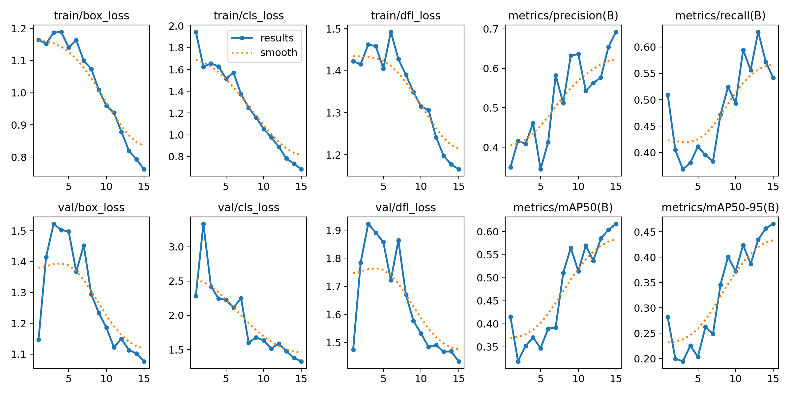
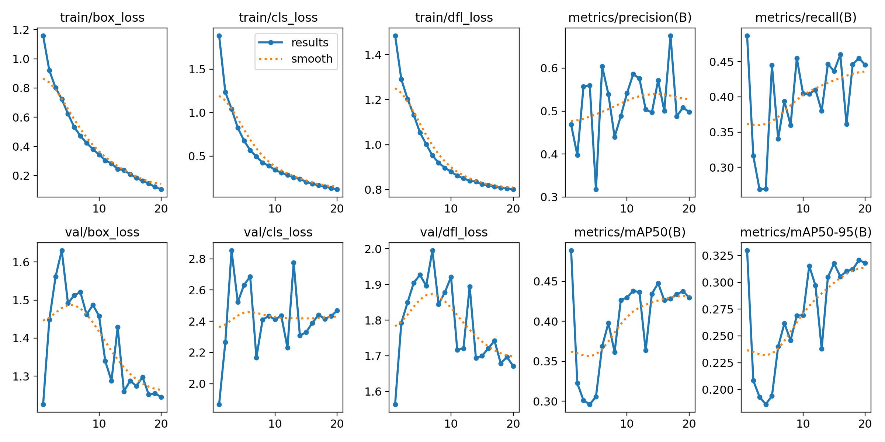

# Traffic Vision: Vehicle Detection, Tracking & Counting Pipeline

## 📌 Project Overview
Traffic Vision is an R&D-focused Computer Vision pipeline designed for civil traffic analysis. The system detects vehicles, tracks their trajectories across frames using Multi-Object Tracking (MOT), and counts vehicles crossing a designated threshold. 

This project goes beyond simple inference by incorporating custom synthetic data generation, rigorous ablation studies on augmentations, and detailed error analysis to optimize model performance for edge cases (e.g., severe occlusion, small objects).

## 🎥 Demo: Tracking & Counting
[Watch the Tracking & Counting Demo Video](report/result_video.mp4)

*(Note: If the video does not play automatically in your browser, download it from the `report/` folder or drag-and-drop a .gif version here).*

## 🛠 Technology Stack
*   **Computer Vision Framework:** YOLOv8 (Ultralytics), PyTorch
*   **Tracking Algorithm:** ByteTrack
*   **Data Pipeline & Classic CV:** Python, OpenCV, NumPy, Pillow (PIL)
*   **Hardware / Environment:** Local CPU (VS Code) & Kaggle GPU (Tesla T4)

## 📁 Project Structure
```text
Traffic_Vision/
├── data/                   # Raw and processed datasets (YOLO format)
├── models/                 # Model weights (baseline, fine-tuned, synthetic-trained)
├── notebooks/              # Jupyter notebooks for data exploration and baseline tests
├── report/                 # Output videos and metric graphs for evaluation
├── synthetic_data/         # Custom pipeline for background compositing and data generation
│   ├── background/
│   ├── motorcycles/
│   ├── output/
│   └── synthetic_generator.py
├── tracker.py              # Main inference script (Detection + Tracking + Counting)
├── requirements.txt        # Project dependencies
└── README.md
```

## 🔬 Experiments & Error Analysis

### 1. Data Augmentation Ablation Study
To understand the impact of spatial and color augmentations on a small dataset, an ablation study was conducted by training a model with default YOLO augmentations (Mosaic, Flip, Scale, HSV) disabled.

*   **Baseline Model (with Augmentation):** mAP50 = `0.640`
*   **Model without Augmentation:** mAP50 = `0.488`
*   **Conclusion:** Disabling augmentations resulted in a **23.7% drop in mAP50** and a **37.7% drop in Precision**. The training loss dropped significantly faster, indicating severe **overfitting** due to a lack of data variance.

**Visual Metric Comparison:**

| With Augmentations | NO Augmentations |
| :---: | :---: |
|  |  |

### 2. Synthetic Data Generation Pipeline
**Problem:** The initial model suffered from Domain Shift and occlusion issues, frequently misclassifying groups of overlapping cars as a single `Motorcycle` or missing small objects entirely.

**Solution:** Developed a custom Python pipeline (`synthetic_generator.py`) utilizing classical CV techniques (alpha-channel masking, compositing) to generate synthetic training data. The script automatically overlays rare classes (motorcycles, trucks) onto empty road backgrounds and mathematically computes normalized YOLO bounding box annotations.

*   **Results:** Integrating 40 synthetic images improved the model's ability to detect difficult objects.
    *   **Recall increased by +8.2%** (from 0.568 to 0.615).
    *   **mAP50-95 increased by +6.8%**, indicating much tighter and more accurate bounding box localization.

**Results of training with Synthetic Data:**


## 🚀 Performance Benchmarking (Inference)
The system's inference latency was evaluated to understand edge-deployment feasibility:
*   **Local CPU:** ~225 ms / frame **(4.4 FPS)**
*   **GPU (Tesla T4):** ~3.6 ms / frame **(277 FPS)**

## 💻 Installation & Usage

1. **Clone the repository and set up the environment:**
   ```bash
   python -m venv venv
   source venv/bin/activate  # On Windows use `venv\Scripts\activate`
   pip install -r requirements.txt
   ```

2. **Run the synthetic data generator (Optional):**
   ```bash
   python synthetic_data/synthetic_generator.py
   ```

3. **Run the vehicle tracking and counting pipeline:**
   ```bash
   python tracker.py
   ```